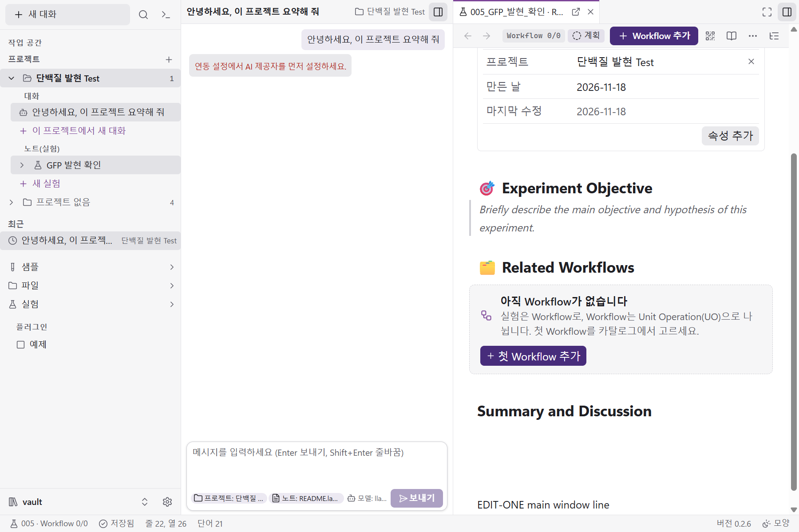
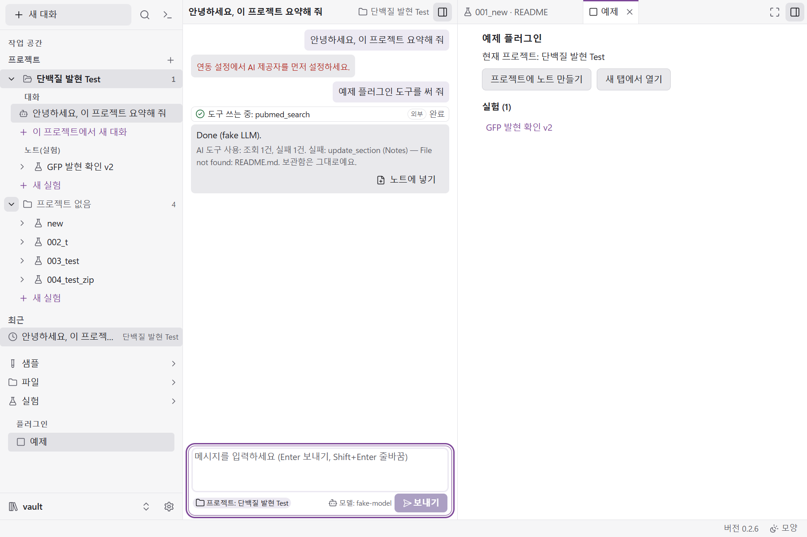
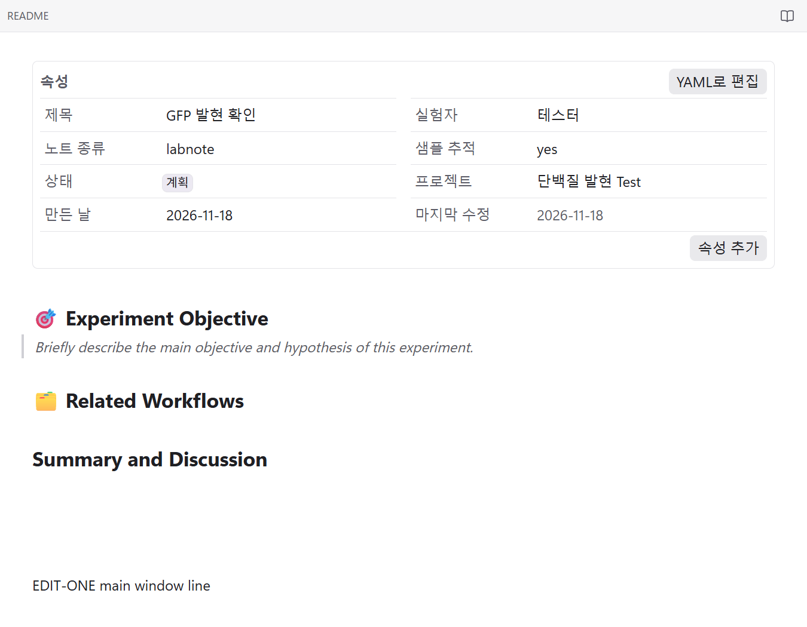
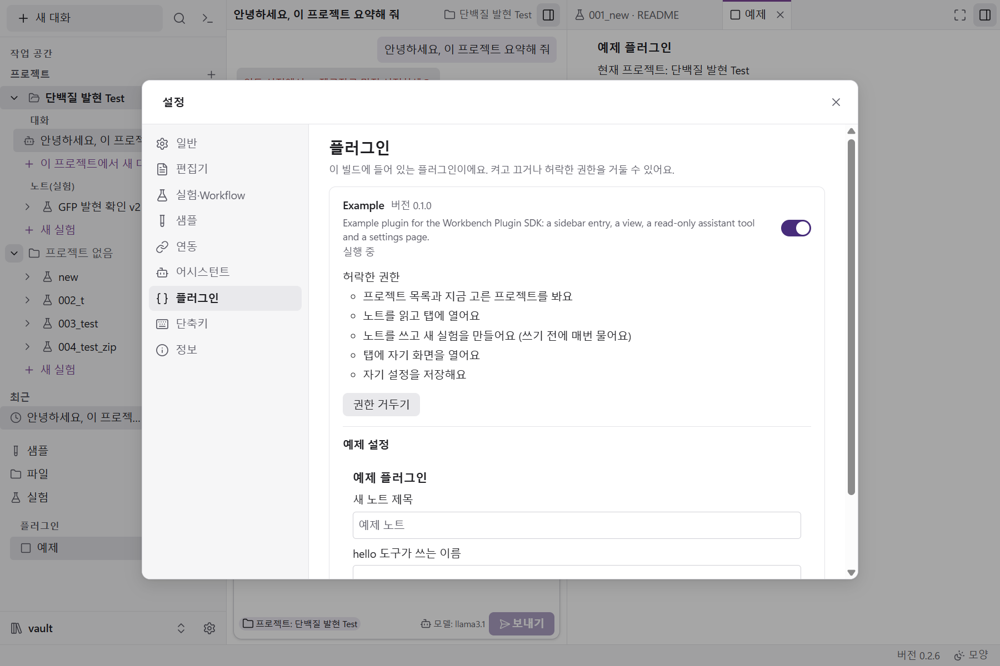
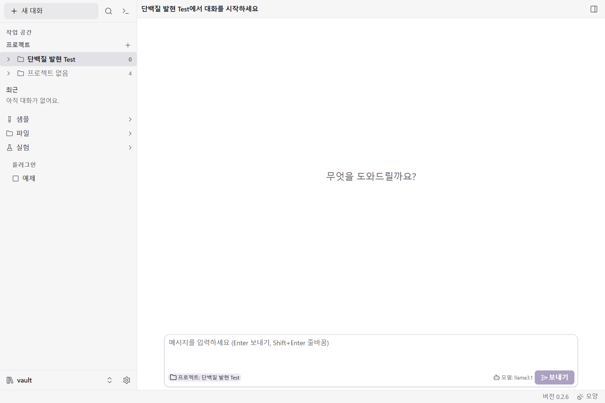

# Biofoundry Workbench

**프로젝트 단위로 AI 에이전트와 대화하고, 연구노트를 탭으로 열고, 바이오파운드리 도구를 플러그인으로 붙이는 데스크톱 연구 워크벤치.**

[English](README.md) · **한국어**

[사용 흐름](#기능) · [화면](#화면) · [라이선스](LICENSE)

> Windows x64 설치 파일은 [최신 GitHub 릴리스](https://github.com/sblabkribb/biofoundry-workbench/releases/latest)에서 받으세요.
> 설치 파일에 Windows 코드 서명이 없어 처음 설치할 때 SmartScreen 경고가 뜰 수 있습니다. 0.1.1부터는 업데이트를
> 설치하기 전에 앱에서 확인을 요청합니다. 더 오래된 빌드를 사용 중이면 최신 버전을 한 번 덮어 설치하세요.

## 소개

Biofoundry Workbench는 LLM 채팅 앱처럼 배치한 Windows 데스크톱 앱(Tauri 2 + React)으로, 바이오파운드리 연구 업무용입니다.

- **프로젝트.** 왼쪽 사이드바에서 실험을 프로젝트로 묶습니다. 프로젝트마다 대화와 연구노트(실험)가 있고, 프로젝트가 없는
  실험은 "프로젝트 없음"에 모입니다.
- **프로젝트 대화.** 가운데는 AI 에이전트와의 대화입니다. 지금 고른 프로젝트와 열린 노트가 에이전트에게 맥락으로 전달됩니다.
  도구 호출은 카드로 보이고, 노트를 바꾸는 작업은 먼저 허락을 받습니다. 에이전트는 작은 입력 양식 카드(A2UI)로 필요한 값을
  물을 수도 있고, 그 카드는 대화 안에서 바로 채워 제출합니다. 설정에서 켠 외부 코딩 에이전트(ACP로 붙는 DeepSeek
  Harness, Claude Code)로 대화를 돌릴 수도 있습니다.
- **연구노트 탭.** 노트는 오른쪽 탭 패널에 열립니다. 여러 탭을 동시에 열 수 있고, 탭을 바꿔도 되돌리기 기록과 스크롤 위치가
  유지됩니다.
- **내장 브라우저.** 웹 페이지를 브라우저 탭에서 열고, PartBank, bfworkflow, RAPID 바로가기가 있습니다. 페이지의 요소나
  영역을 골라 대화에 첨부하거나 **노트에 넣기**로 노트에 바로 넣을 수 있고, 도우미는 허용한 사이트만 읽으며 클릭·입력은
  매번 승인한 뒤에만 합니다.
- **대화별 참고 자료와 모델.** "+"나 `@`로 다른 대화, 실험 폴더, 워크플로, 유닛 오퍼레이션, 노트, 브라우저에서 고른 요소를
  대화에 첨부하고, 머리글에서 대화를 바꾸고 대화마다 모델을 고릅니다.
- **창 분리.** 어떤 탭이든 별도 창으로 떼어낼 수 있습니다. 예를 들어 노트는 한 창, 플러그인 화면은 다른 창에 둘 수 있고,
  분리한 창에서 고친 내용은 메인 창에도 반영됩니다.
- **데스크톱 펫.** labnoteO Desktop의 펫은 Workbench에서 기본적으로 숨겨져 있습니다. **설정 › 어시스턴트 › 어시스턴트 보이기**를
  켜거나 왼쪽 리본의 로봇 버튼을 누르면 나타납니다.
- **플러그인.** 분야별 도구는 버전이 있는 작은 SDK에 맞춰 각자의 저장소에서 개발하는 플러그인으로 붙입니다. 플러그인은
  사이드바 항목, 탭에 열리는 화면, 에이전트가 쓰는 도구, 설정 페이지를 더할 수 있습니다. 이 버전에는 예제 플러그인이 들어 있습니다.

노트 편집기, 실험 구조(Workflow, Unit Operation), 샘플, 파일, 검색, 어시스턴트 도구는 이 앱의 기반인 labnoteO Desktop에서
가져왔습니다.

## 기능

### 프로젝트 대화에서 연구노트까지

GFP 발현 프로젝트에서 대화를 시작하고, 웹의 결과를 실험 노트에 남기는 예입니다. 영상은 데모 보관함과 예시 응답으로 찍었습니다.

**1. 보관함을 열고 프로젝트에서 대화를 시작합니다.** labnoteO 보관함을 연 뒤 왼쪽 사이드바에서 프로젝트를 고릅니다.
**설정 › 연동 › AI 제공자**에서 모델을 연결하고, 대화에서 사용할 실험 폴더와 모델을 고릅니다.

**2. 질문에 필요한 기록을 첨부합니다.** **+** 또는 **@**로 이전 대화, 노트, Workflow, Unit Operation을 붙입니다.
첨부는 칩으로 표시되며 메시지를 보낼 때 참고 자료를 다시 읽습니다.

**3. 웹에서 찾은 결과를 실험에 남깁니다.** 브라우저 탭에서 출처를 열고 **Ctrl+Shift+S**를 누릅니다.
필요한 결과 표를 고른 뒤 **노트에 넣기**를 누르면 표와 출처 링크가 함께 들어갑니다.
채팅에서 키워드로 웹을 검색하려면 **설정 › 어시스턴트 › 웹 검색 주소**에서 SearXNG 서버를 연결합니다.
서버에 연결된 검색 엔진이 색인한 공개 사이트가 결과에 포함됩니다.

**4. 에이전트가 제안한 다음 작업을 확인합니다.** 필요한 정보는 대화 안의 양식 카드에 채웁니다.
외부 에이전트가 노트를 고치려면 승인 카드에서 수정 내용을 먼저 확인합니다.

**5. 앱을 최신으로 유지합니다.** Workbench를 열면 공개 릴리스를 확인하고 백그라운드에서 내려받습니다.
다운로드가 끝나면 왼쪽 아래 **업데이트**를 누릅니다. 영상 마지막에는 공개 Windows 빌드 `v0.1.1`이 `v0.1.2`를
내려받는 과정이 나옵니다.

[한국어 전체 영상 보기](https://sblabkribb.github.io/biofoundry-workbench/ko/) · [MP4](docs/media/research-workflow.ko.mp4)

| 시간 | 내용 |
| --- | --- |
| 0:00 | 프로젝트 대화 시작 |
| 0:14 | 실험 참고 자료 첨부 |
| 0:29 | 웹 결과와 출처를 노트에 기록 |
| 0:43 | 대화에서 양식 제출 |
| 0:56 | 외부 에이전트의 수정 검토 |
| 1:10 | Workbench 업데이트 다운로드 |

### RAPID 연결

**설정 › 연동 › 외부 MCP 서버**에서 **RAPID**를 선택하고 RAPID에서 발급한 인증 정보를 저장합니다.
**연결 확인**에서 계정으로 사용할 수 있는 도구를 확인합니다. 브라우저 탭에서 RAPID 실행 결과를 열고 노트에 실행 정보를 넣을 수도 있습니다.

## 화면

화면과 영상은 테스트 보관함과 예시 데이터로 촬영했습니다. 전체 영상은 이전에 찍어 둔 실제 앱 화면을 이어 편집했습니다.

**프로젝트 대화와 노트 탭.** 사이드바에 프로젝트와 그 대화, 노트가 보입니다. 입력창 아래에 에이전트에게 전달되는 프로젝트와
노트가 표시되고, 오른쪽 탭 패널에서 노트를 열어 고쳤습니다.

**에이전트 답변과 플러그인 화면.** 프로젝트 대화에 도구 호출 카드와 에이전트 답변(테스트용 LLM)이 있고, 탭에는 프로젝트의
실험 목록을 보여주는 예제 플러그인 화면이 열려 있습니다.

**분리한 창.** 노트 탭을 별도 창으로 떼어냈습니다.

**설정 › 플러그인.** 빌드에 들어 있는 플러그인을 켜고 끌 수 있고, 허락한 권한을 보고 거둘 수 있으며, 그 아래에 플러그인
자체 설정 페이지가 나옵니다.

**새 프로젝트.** 만든 빈 프로젝트가 사이드바에 나타나고, 그 안에서 대화를 시작할 수 있습니다.

Phase 1 흐름의 다른 화면은 [docs/workbench/screens](docs/workbench/screens)에 있습니다.

## 출처

[labnoteO Desktop](https://github.com/sblabkribb/labnoteo-desktop)을 기반으로 만들었습니다. [저작권 고지](NOTICE) · [서드파티 고지](THIRD_PARTY_NOTICES.md)
