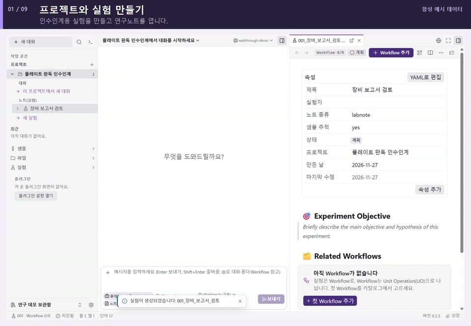
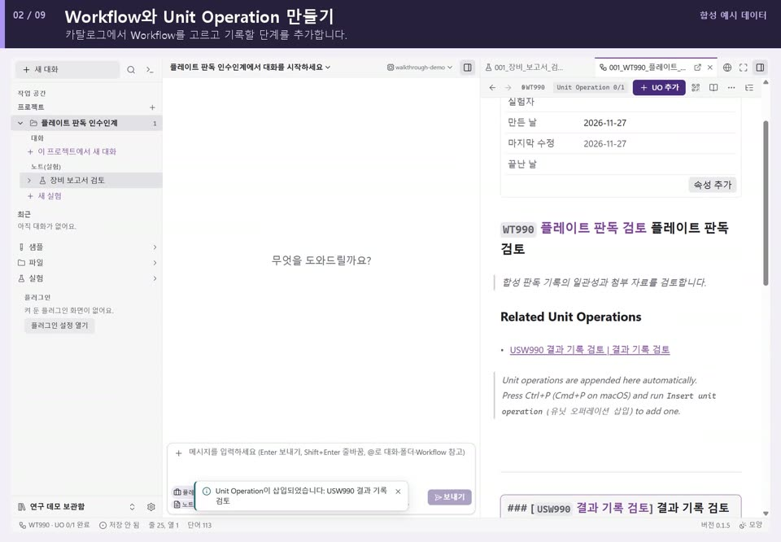
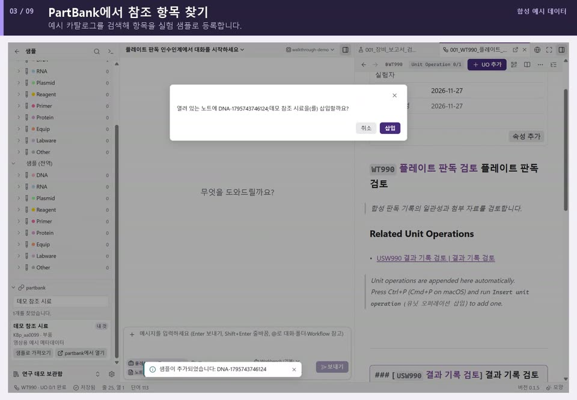
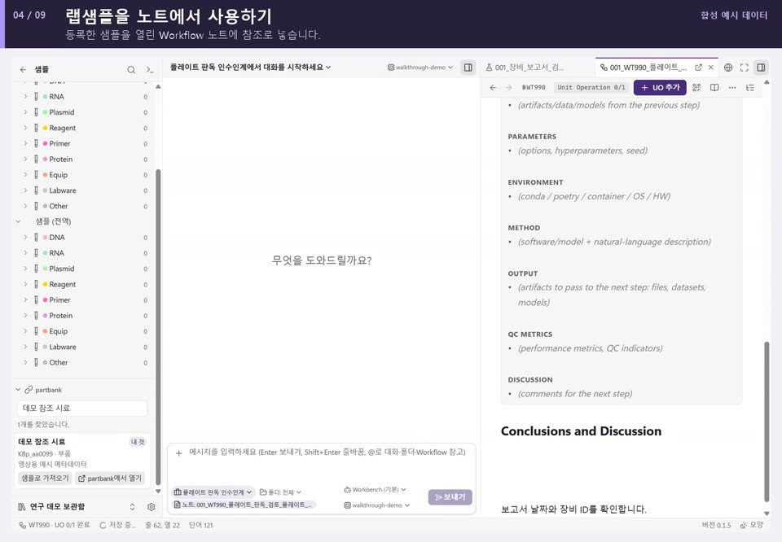
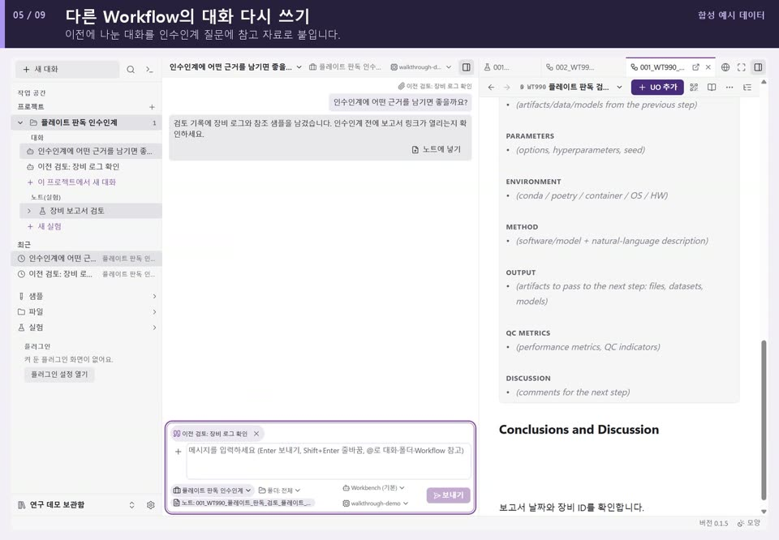
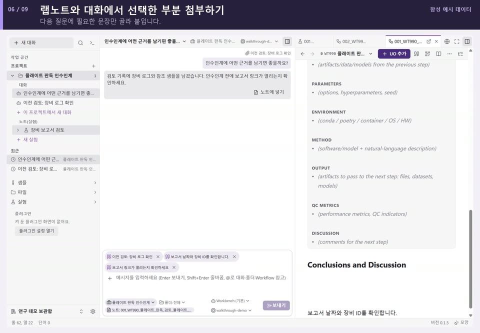
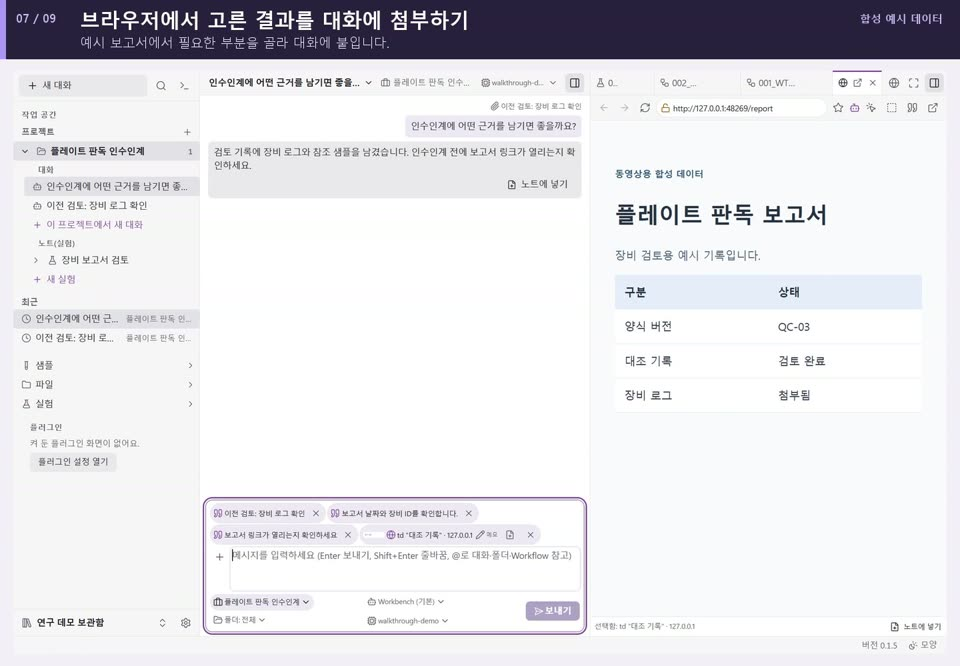
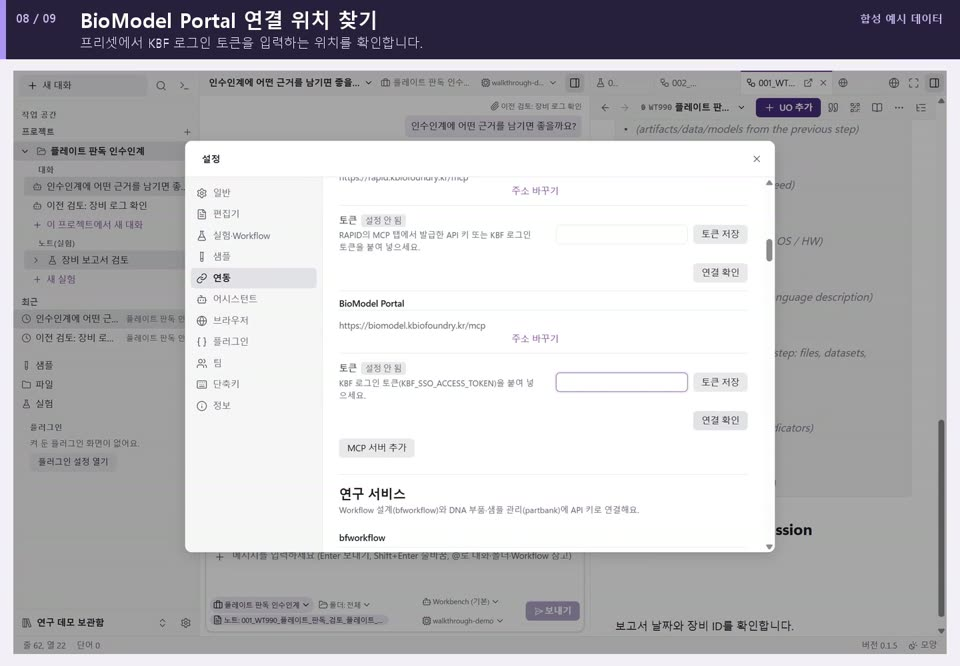
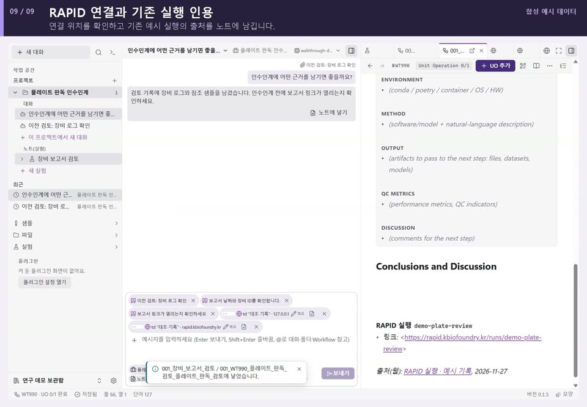

# Biofoundry Workbench

**실험을 계획하고, 팀의 기록을 다시 쓰고, 결과의 근거를 연구노트에 남깁니다.**

[English](README.md) · **한국어** · [Windows 다운로드](https://github.com/sblabkribb/biofoundry-workbench/releases/latest) · [전체 영상 보기](https://sblabkribb.github.io/biofoundry-workbench/ko/)

## 시작하기

Windows x64 앱을 설치하고 보관함을 엽니다. labnoteO 보관함이 있으면 **기존 폴더 열기**, 연습할 폴더가 필요하면 **새 보관함 만들기**를 선택합니다. 채팅을 보내려면 **설정 › 연동 › AI 제공자**에서 모델을 연결하거나 대화 입력창에서 로그인한 외부 에이전트를 선택합니다. 보관함을 열면 노트 작성과 참고 자료 선택을 시작할 수 있습니다.

## 따라 하기 · 플레이트 판독 검토 인수인계

동료가 남긴 플레이트 판독 기록을 검토한다고 가정합니다. 인수인계용 실험을 만들고 Workflow와 Unit Operation을 추가한 뒤, 샘플과 이전 대화의 결정 사항, 웹 보고서의 근거를 한 프로젝트에 모읍니다. 영상은 독립된 데모 보관함과 합성 기록을 사용합니다.

[전체 MP4](docs/media/walkthrough/ko/walkthrough.mp4)

BioModel Portal과 RAPID의 연결 위치를 보여줍니다. RAPID 인용에는 합성 실행 기록을 사용합니다. 실제 접속에는 각 서비스의 인증 정보가 필요합니다.

[프로젝트 시작](#1-프로젝트와-실험-만들기) · [workflow 만들기](#2-workflow와-unit-operation-만들기) · [PartBank 찾기](#3-partbank에서-참조-항목-찾기) · [랩샘플 사용](#4-랩샘플을-노트에서-사용하기) · [이전 대화 재사용](#5-다른-workflow의-대화-다시-쓰기) · [선택한 텍스트 첨부](#6-랩노트와-대화에서-선택한-부분-첨부하기) · [브라우저에서 첨부](#7-브라우저에서-고른-결과를-대화에-첨부하기) · [BioModel Portal](#8-biomodel-portal-연결-확인) · [RAPID](#9-기존-rapid-실행을-노트에-인용하기)

### 1. 프로젝트와 실험 만들기

사이드바에서 **새 프로젝트**를 만듭니다. 프로젝트를 펼치고 **새 실험**을 누르면 실험의 README 노트가 오른쪽에 열립니다. **이 프로젝트에서 새 대화**로 프로젝트에 속한 채팅을 시작할 수 있습니다.

[MP4 보기](docs/media/walkthrough/ko/01-project.mp4)

### 2. Workflow와 Unit Operation 만들기

실험 노트에서 **Workflow 추가**를 누릅니다. 카탈로그에서 항목을 고르고 이름을 붙인 뒤, 열린 Workflow에서 **UO 추가**를 눌러 실제로 기록할 단계를 만듭니다. 영상에서는 기존 장비 보고서를 검토하는 단계를 추가합니다.

팀의 템플릿을 가져오려면 **설정 › 연동 › 연구 서비스 › bfworkflow**에서 서버나 데스크톱 앱을 고르고 API 키를 저장합니다. **Ctrl+P → bfworkflow 카탈로그 동기화하기**로 변경 사항을 확인합니다. 기존 노트는 **bfworkflow 설계에서 노트 만들기 → bfworkflow에 저장된 노트 쓰기**로 실험에 가져올 수 있습니다. [bfworkflow 열기](https://workflow.kbiofoundry.kr/)

[MP4 보기](docs/media/walkthrough/ko/02-workflow.mp4)

### 3. PartBank에서 참조 항목 찾기

**설정 › 연동 › 연구 서비스 › partbank**에서 서버 또는 데스크톱 앱의 주소와 API 키를 저장하고 **검색에 쓸 연결**을 고릅니다. API 키는 PartBank의 **Profile › API Keys**에서 발급합니다. [PartBank 열기](https://partbank.kbiofoundry.kr/)

**샘플 › partbank**에서 참조 항목을 찾아 **샘플로 가져오기**를 누릅니다. 같은 검색 결과에서 PartBank 원본을 열어 확인할 수 있습니다.

[MP4 보기](docs/media/walkthrough/ko/03-partbank.mp4)

### 4. 랩샘플을 노트에서 사용하기

Workflow 노트를 열어 둔 상태에서 샘플을 등록하고 **삽입**을 누릅니다. 나중에 다시 쓰려면 **샘플**에서 해당 항목을 우클릭하고 **참조 삽입**을 선택합니다. 노트에는 샘플 ID와 별칭이 함께 남습니다.

[MP4 보기](docs/media/walkthrough/ko/04-sample.mp4)

### 5. 다른 Workflow의 대화 다시 쓰기

새 프로젝트 대화에서 **@**를 입력하거나 **+**를 누릅니다. **대화**에서 이전 대화를 골라 붙입니다. 관련 Workflow나 Unit Operation도 함께 첨부할 수 있습니다. 메시지를 보내기 전에 입력창 아래에서 첨부 항목을 확인합니다.

[MP4 보기](docs/media/walkthrough/ko/05-reuse.mp4)

### 6. 랩노트와 대화에서 선택한 부분 첨부하기

노트에서 필요한 문단만 드래그한 뒤 **선택한 텍스트 첨부**를 누릅니다. 대화 메시지에서도 같은 방법으로 문장을 고릅니다. 입력창에 두 선택이 모두 붙으면 그 부분을 중심으로 질문할 수 있습니다.

[MP4 보기](docs/media/walkthrough/ko/06-selection.mp4)

### 7. 브라우저에서 고른 결과를 대화에 첨부하기

Workbench의 브라우저 탭에서 보고서를 엽니다. 문장을 선택하고 **선택한 텍스트 첨부**를 누르거나, **Ctrl+Shift+S**로 요소나 영역을 고릅니다. 출처를 노트에 남길 때는 **노트에 넣기**를 선택합니다.

[MP4 보기](docs/media/walkthrough/ko/07-browser.mp4)

### 8. BioModel Portal 연결 확인

**설정 › 연동 › 외부 MCP 서버 › BioModel Portal**에서 KBF 로그인 토큰을 **토큰 저장**으로 등록하고 **연결 확인**을 누릅니다. 연결된 서버와 계정으로 접근 가능한 도구 수가 표시됩니다. 모델 목록은 포털에 로그인해 확인합니다. [BioModel Portal 열기](https://biomodel.kbiofoundry.kr/)

[MP4 보기](docs/media/walkthrough/ko/08-biomodel.mp4)

### 9. 기존 RAPID 실행을 노트에 인용하기

**설정 › 연동 › 외부 MCP 서버 › RAPID**에서 RAPID의 **MCP** 탭에서 발급한 키 또는 KBF 로그인 토큰을 저장하고 **연결 확인**을 누릅니다. Workbench 브라우저에서 기존 실행 결과를 열고 필요한 부분을 고릅니다. 실행 ID가 인식되면 **노트에 넣기 › RAPID 실행 넣기**로 ID와 출처를 검토 기록에 남깁니다. [RAPID 열기](https://rapid.kbiofoundry.kr/)

[MP4 보기](docs/media/walkthrough/ko/09-rapid.mp4)

## 자주 쓰는 기능

| 하고 싶은 일 | Workbench에서 |
| --- | --- |
| 구독 계정으로 대화하기 | **설정 › 연동 › 에이전트**에서 로그인 안내를 따른 뒤 입력창에서 에이전트를 고릅니다. Codex는 ChatGPT 계정으로 연결합니다. |
| 대화 옆에 노트 띄우기 | 오른쪽 탭에서 노트를 보거나 탭의 분리 버튼으로 별도 창에 엽니다. |
| 에이전트가 제안한 편집 검토하기 | 승인 카드의 변경 내용부터 확인합니다. 추가 정보는 대화의 양식 카드에 채웁니다. |
| 바탕화면 펫 쓰기 | **설정 › 어시스턴트 › 어시스턴트 보이기**에서 켭니다. v0.1.5의 펫은 현재 대화의 AI 연결과 모델을 사용합니다. |
| 업데이트 적용하기 | 앱이 백그라운드에서 내려받으면 상태 표시줄의 **업데이트**를 누릅니다. |

## 출처

[labnoteO Desktop](https://github.com/sblabkribb/labnoteo-desktop)을 기반으로 만들었습니다. [저작권 고지](NOTICE) · [서드파티 고지](THIRD_PARTY_NOTICES.md)
