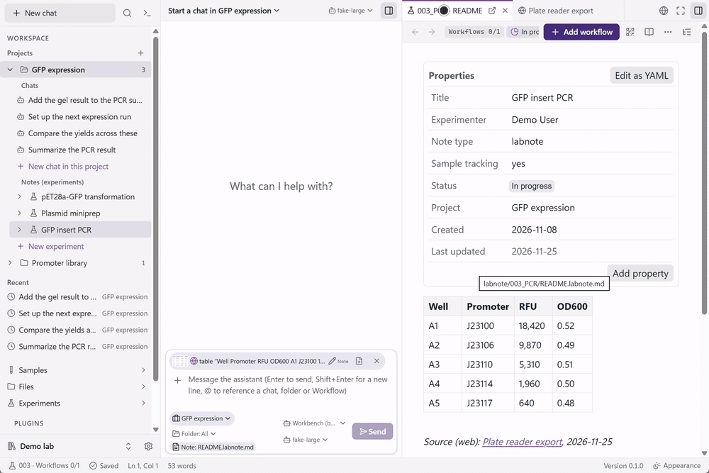
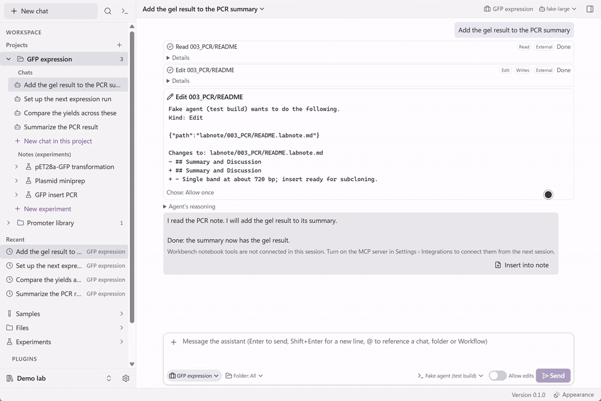
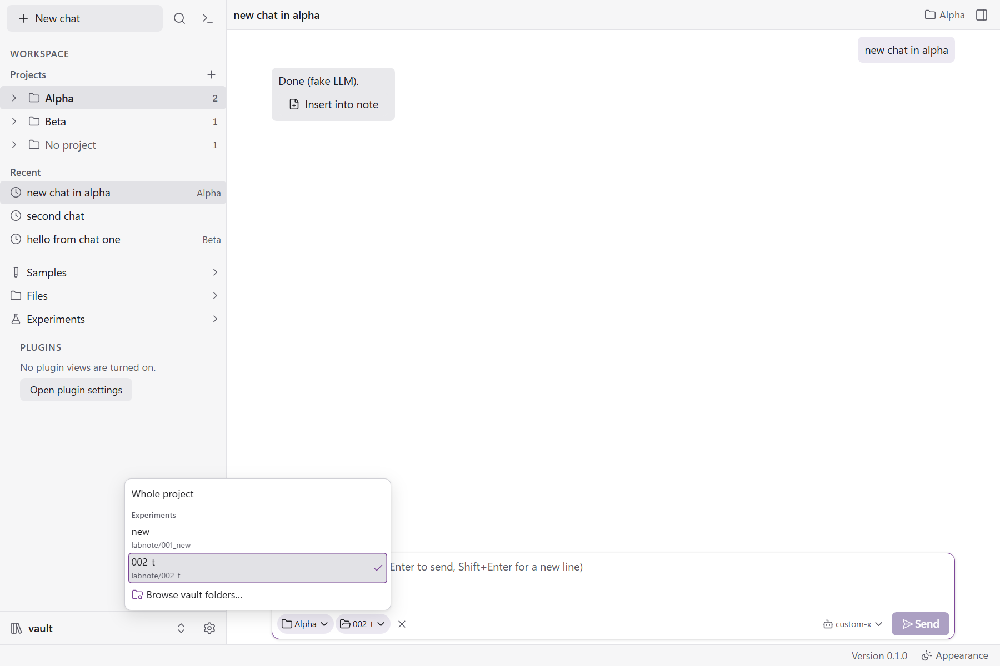
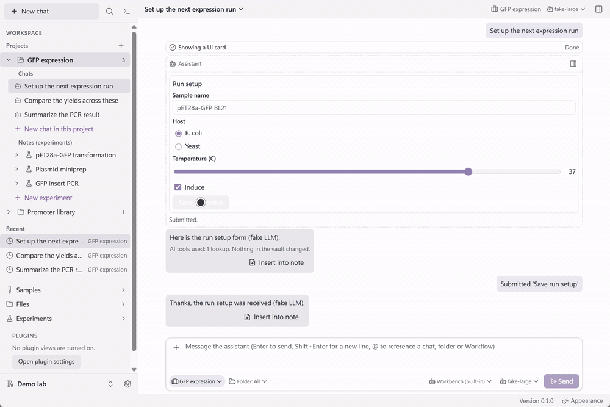

# Biofoundry Workbench

**A desktop research workbench: project chat with an AI agent, research notes in tabs, and plugins for biofoundry tools.**

**English** · [한국어](README.ko.md)

[Get started](#features) · [BioModel Portal](#connect-biomodel-portal) · [Screenshots](#screenshots) · [License](LICENSE)

> Download the Windows x64 installer from the [latest GitHub release](https://github.com/sblabkribb/biofoundry-workbench/releases/latest).
> Windows SmartScreen may warn on first install because the installer is unsigned. Workbench 0.1.1 and later ask before
> installing an update. If you're using an older build, install the latest release over it once.

## What it is

Biofoundry Workbench is a Windows desktop app (Tauri 2 + React) laid out like an LLM chat client, built for
research work in a biofoundry:

- **Projects.** The left sidebar groups experiments into projects. Each project holds its chats and its
  research notes (experiments). Experiments without a project sit under "No project".
- **Project chat.** The center is a chat with the AI agent. The active project and the open note are given to the
  agent as context. Tool calls are shown as cards, and changes to notes need your approval first. The agent can also
  ask for details with a small form card (A2UI) that you fill in and submit right in the chat. A chat can also run
  on an external coding agent (DeepSeek Harness or Claude Code over ACP) that you turn on in Settings.
- **Research notes in tabs.** Notes open in a tab panel on the right. Several tabs stay open at once and keep their
  undo history and scroll position when you switch.
- **Built-in browser.** Web pages open in a browser tab, with quick links to PartBank, bfworkflow and RAPID. Pick an
  element or a region of a page and attach it to the chat, or put it straight into a note with **Insert into note**;
  the assistant can read allowlisted sites and click or type only after you approve each action.
- **References and models per chat.** Attach other conversations, experiment folders, Workflows, Unit Operations,
  notes or browser picks to a chat with "+" or `@`, switch conversations from the header and pick the model per chat.
- **Detachable windows.** Any tab can be popped out into its own window, for example a note in one window and a plugin
  view in another. Edits made there show up in the main window.
- **Desktop pet.** The labnoteO Desktop pet is available in Workbench and starts hidden. Turn it on in
  **Settings › Assistant › Show assistant**, or use the robot button in the left ribbon.
- **Plugins.** Domain tools come as plugins written against a small, versioned SDK and developed in their own
  repositories. A plugin can add a sidebar entry, views that open in tabs, tools the agent can call, and a settings
  page. This release includes an example plugin.

The note editor, experiment structure (Workflows, Unit Operations), samples, files, search and the assistant's tools come
from labnoteO Desktop, on which this app is based.

## Features

### Follow a research task from chat to notebook

This example follows a GFP expression project. The demo vault, model answers, and sample web data are recorded examples.

**1. Open a vault and start in a project.** Open your labnoteO vault, select a project in the sidebar, and start a
chat. In **Settings › Integrations › AI provider**, connect your model. Set the experiment folder and model for
the current chat so you can ask about a particular note or result.

**2. Give the assistant the relevant records.** Use **+** or **@** to add a previous conversation, a note, a
Workflow, or a Unit Operation. The attachments appear as chips, and references are read again when you send a message.

**3. Bring a result from the browser into the experiment.** Open the source in a browser tab. Press **Ctrl+Shift+S**,
choose the relevant table, and click **Insert into note**. The notebook keeps the table and a source link together.
For general keyword searches in chat, configure a SearXNG server under **Settings › Assistant › Web search address**.
Results can come from any public domain indexed by the server's search engines.

**4. Review the assistant's next step.** Fill in a form card in the chat when the assistant needs more information.
Review the planned change in the approval card before letting an external agent edit a note.

**5. Keep the app current.** Workbench checks the public release channel on startup and downloads the update in the
background. Click **Update** at the bottom left when the app has it ready. The final chapter shows the published
Windows build updating from `v0.1.1` to `v0.1.2` through the download stage.

[Watch the English overview](https://sblabkribb.github.io/biofoundry-workbench/) · [MP4](docs/media/research-workflow.en.mp4)

| Time | Chapter |
| --- | --- |
| 0:00 | Start a project chat |
| 0:14 | Attach research context |
| 0:29 | Cite a web result in a note |
| 0:43 | Submit a form card |
| 0:57 | Review an external agent's edit |
| 1:11 | Download a Workbench update |

### Connect RAPID

Open **Settings › Integrations › External MCP servers**, choose **RAPID**, and save your RAPID bearer credential.
Use the connection check to see which tools your account can access. You can also open RAPID in a browser tab and
add a run reference to a note.

### Connect BioModel Portal

Workbench v0.1.5 includes a **BioModel Portal** preset. Open **Settings › Integrations › External MCP servers**,
select **BioModel Portal**, and use **Save token** to store your KBF sign-in token (`KBF_SSO_ACCESS_TOKEN`). Select
**Test connection** to check the server connection and see how many MCP tools your account can access.
Select the chat agent and model in the composer. To browse the model catalog, sign in to [BioModel Portal](https://biomodel.kbiofoundry.kr/).

## Screenshots

Taken from the English UI with demo data. The overview combines previously recorded clips from the app.

**Project chat with a note tab.** The left sidebar shows the project, its chats and its notes. The experiment note
stays open on the right alongside the project chat.

**Agent answer and tool calls.** The project chat shows the test agent's read and edit calls, the approved change,
and the answer.

**Folder picker.** Choose an experiment folder to narrow the context of the current chat.

**Form card.** The assistant can collect setup details in the chat and acknowledge them after submission.

## Credits

Built on [labnoteO Desktop](https://github.com/sblabkribb/labnoteo-desktop). [Notices](NOTICE) · [Third-party notices](THIRD_PARTY_NOTICES.md)
