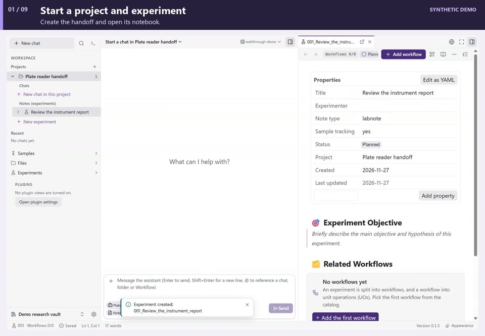
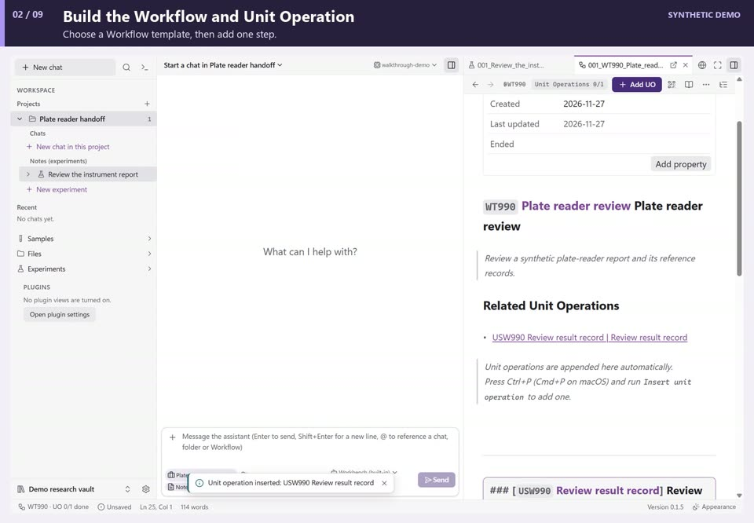
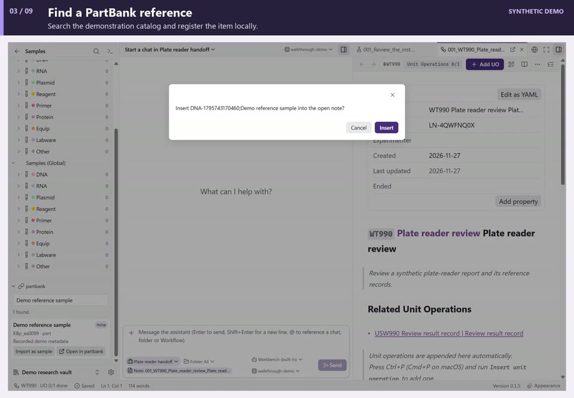
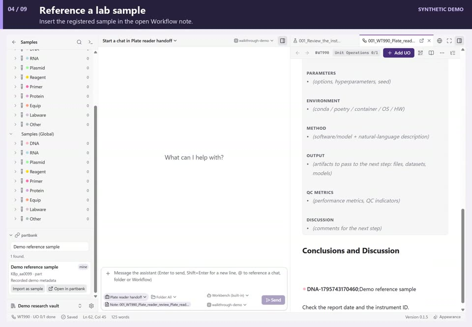
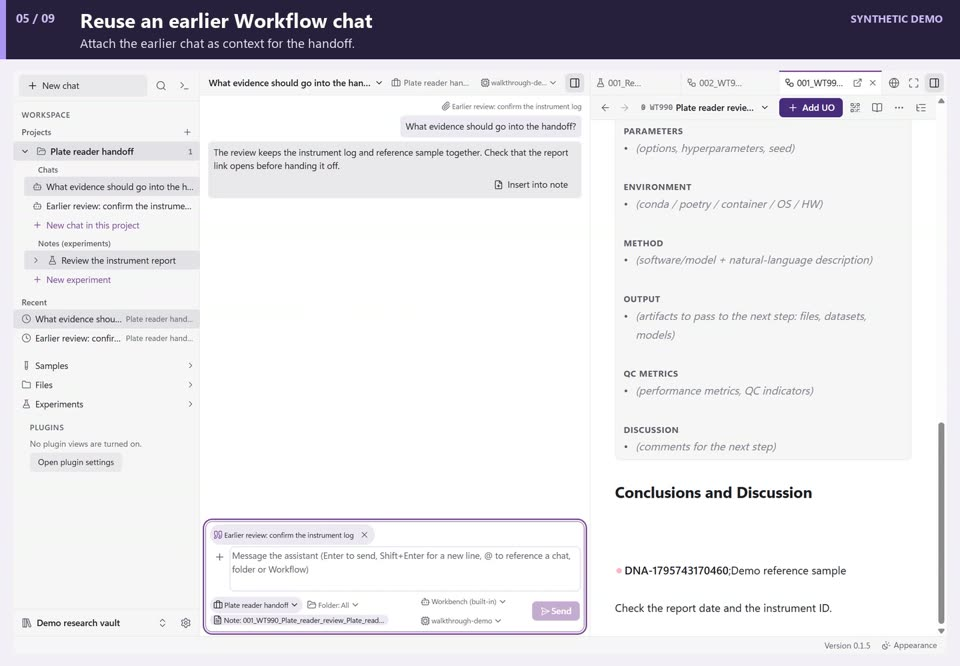
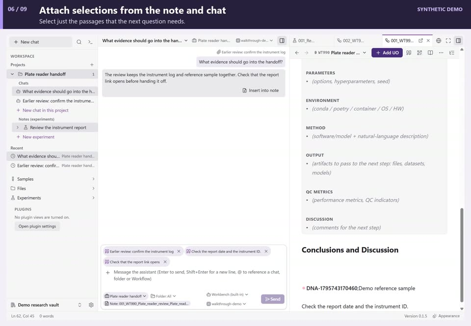
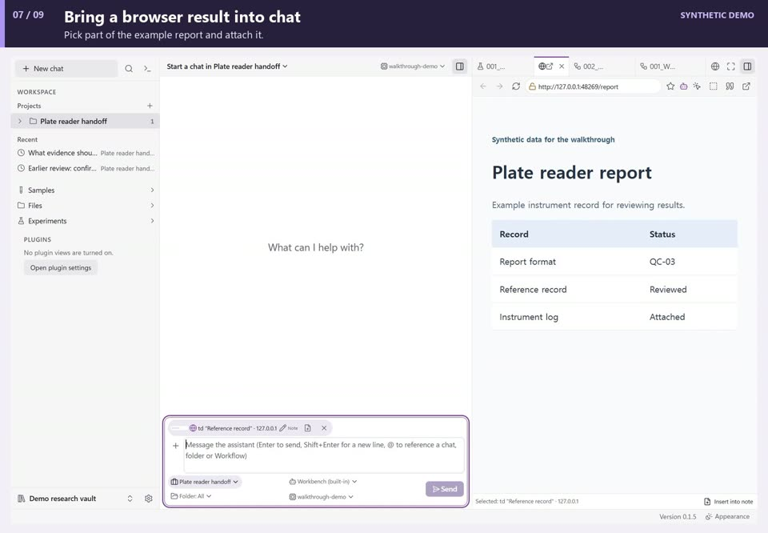
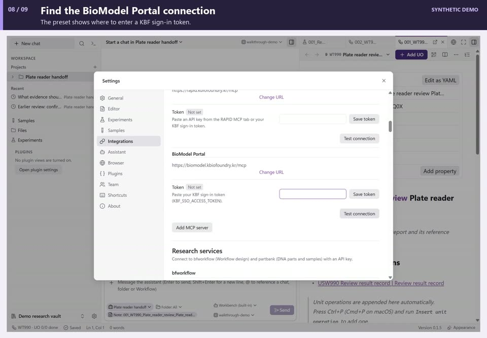
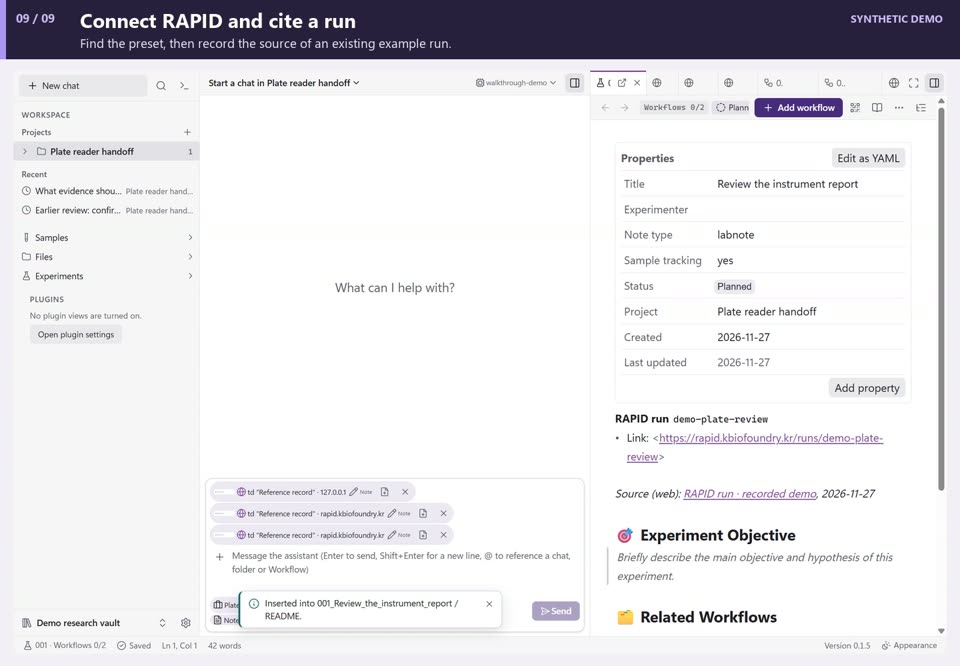

# Biofoundry Workbench

**Plan an experiment, reuse what your team already knows, and leave the evidence in a lab notebook.**

**English** · [한국어](README.ko.md) · [Download for Windows](https://github.com/sblabkribb/biofoundry-workbench/releases/latest) · [Watch the full walkthrough](https://sblabkribb.github.io/biofoundry-workbench/)

## Start here

Install the Windows x64 app and open a vault. Choose **Open existing folder** to use an existing labnoteO vault, or **Create a new vault** to follow along in a test folder. To send a message, connect a model in **Settings › Integrations › AI provider** or choose a signed-in external agent from the chat composer. You can create notes and select references as soon as the vault opens.

## Walkthrough · Hand off a plate-reader review

You are picking up a plate-reader review from a colleague. Create an experiment for the handoff, fill in its Workflow and Unit Operation, then bring the sample, previous decisions, and sources into the same project. The footage uses an isolated Workbench vault and synthetic records.

[Full MP4](docs/media/walkthrough/en/walkthrough.mp4)

The clips show where to connect BioModel Portal and RAPID. The RAPID citation uses a synthetic run record. Live access requires credentials from each service.

[Start a project](#1-start-a-project-and-experiment) · [Build the Workflow](#2-build-the-workflow-and-unit-operation) · [Find a PartBank record](#3-find-the-partbank-reference) · [Use a lab sample](#4-use-the-lab-sample-in-a-note) · [Reuse another chat](#5-reuse-another-workflow-chat) · [Attach selected text](#6-attach-selections-from-a-note-and-chat) · [Bring in a browser result](#7-bring-a-browser-result-into-chat) · [Check BioModel Portal](#8-check-biomodel-portal) · [Cite a RAPID run](#9-cite-an-existing-rapid-run)

### 1. Start a project and experiment

Choose **New project** in the sidebar and name it after the work. Expand the project and choose **New experiment**. Workbench opens the experiment's README note in the right panel. Use **New chat in this project** when you want a conversation that belongs to that project.

[MP4](docs/media/walkthrough/en/01-project.mp4)

### 2. Build the Workflow and Unit Operation

In the experiment note, choose **Add workflow**, pick a catalog entry, and give it a name. Open that Workflow and choose **Add UO** to create a Unit Operation for a specific step. For the walkthrough, the step is reviewing a saved instrument report.

To bring your team's templates in, use **Settings › Integrations › Research services › bfworkflow**. Choose the server or desktop app and save its API key. From **Ctrl+P**, run **Sync catalogs from bfworkflow** and review the changes. Use **Create notes from a bfworkflow design** and **Use the notes saved in bfworkflow** to bring existing notes into the experiment. [Open bfworkflow](https://workflow.kbiofoundry.kr/)

[MP4](docs/media/walkthrough/en/02-workflow.mp4)

### 3. Find the PartBank reference

Set your **partbank server** or **partbank desktop app** address and API key under **Settings › Integrations › Research services › partbank**, then set **Connection to search**. PartBank issues keys under **Profile › API Keys**. [Open PartBank](https://partbank.kbiofoundry.kr/)

Open **Samples › partbank**, search for the reference, and choose **Import as sample**. Check the source record from the same result before you use it in the review.

[MP4](docs/media/walkthrough/en/03-partbank.mp4)

### 4. Use the lab sample in a note

With the Workflow note open, accept the **Insert** prompt after registering the sample. To reuse it later, right-click the sample in **Samples** and select **Insert reference**. Workbench records the sample ID and alias in the note.

[MP4](docs/media/walkthrough/en/04-sample.mp4)

### 5. Reuse another Workflow chat

Open a new project chat and type **@** or select **+**. Choose the earlier conversation from **Conversations**. You can also attach the relevant Workflow or Unit Operation. Check the chips above the composer before sending your question.

[MP4](docs/media/walkthrough/en/05-reuse.mp4)

### 6. Attach selections from a note and chat

Highlight the specific paragraph in the note and choose **Attach selected text**. Repeat with a passage in a chat message. Workbench puts each selected passage in the composer so you can ask about those details together.

[MP4](docs/media/walkthrough/en/06-selection.mp4)

### 7. Bring a browser result into chat

Open the saved report in a Workbench browser tab. Select the relevant passage and use **Attach selected text**, or use **Ctrl+Shift+S** to pick an element or area. Choose **Insert into note** if you want to save the selected result with its source link.

[MP4](docs/media/walkthrough/en/07-browser.mp4)

### 8. Check BioModel Portal

Open **Settings › Integrations › External MCP servers › BioModel Portal**. Use **Save token** with your KBF sign-in token and select **Test connection**. The check reports the server and tool count for your account. Browse the model catalog after signing in to the portal. [Open BioModel Portal](https://biomodel.kbiofoundry.kr/)

[MP4](docs/media/walkthrough/en/08-biomodel.mp4)

### 9. Cite an existing RAPID run

Open **Settings › Integrations › External MCP servers › RAPID**. Save a key from the RAPID **MCP** tab or a KBF sign-in token, then select **Test connection**. Open an existing run in the Workbench browser. Pick the result and choose **Insert into note › Insert RAPID run** when its run ID is recognized. Keep the ID and source alongside the review. [Open RAPID](https://rapid.kbiofoundry.kr/)

[MP4](docs/media/walkthrough/en/09-rapid.mp4)

## Everyday controls

| When you want to… | In Workbench |
| --- | --- |
| Use a subscription | Open **Settings › Integrations › Agents**, follow the sign-in instructions for the agent, then select it in the composer. Codex uses your ChatGPT login. |
| Keep a note visible beside chat | Leave it in the right tab panel or use the tab's pop-out button to open a separate window. |
| Review an agent's proposed edit | Read the approval card before applying the edit. Complete any requested form in chat. |
| Show the desktop pet | Use **Settings › Assistant › Show assistant**. In v0.1.5 the pet uses the active chat's AI connection and model. |
| Apply an update | Workbench downloads a release in the background. Click **Update** in the status bar when it is ready. |

## Credits

Built on [labnoteO Desktop](https://github.com/sblabkribb/labnoteo-desktop). [Notices](NOTICE) · [Third-party notices](THIRD_PARTY_NOTICES.md)
